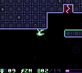
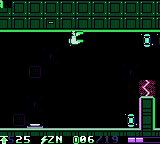
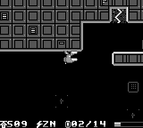
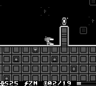

<h1 align="center">ALIGNMENT</h1>

<p align="center">
  <b>An endless gravity-flipping action puzzler for the Game Boy and Game Boy Color.</b><br>
  <i>Sister cartridge to Infinite Best, Open World and Speedy Purple Peter. No guns. Just gravity.</i>
</p>

<p align="center">
  
</p>

<p align="center">
  
  
  
</p>

---

You pilot a small mech through an orbital station whose gravity you control. **Press A and
up becomes down.** There is no weapon on board: every drone, crusher and laser gate is a
timing and gravity problem, and the station itself is the puzzle.

Every stage is a long scrolling corridor of 10 to 13 screens, in the spirit of **Metal Storm**
(Irem, 1991): ceilings become floors, shafts open up and down, phase blocks are solid in only
one gravity, and the exit gate waits at the far end. A checkpoint sits halfway. The stages
never run out: they are generated from a seed, so stage 40 of seed `1234` is the same stage
on every cartridge.

## Controls

| Button | |
| --- | --- |
| **A** | flip gravity (any time on the ground, once in the air until you land) |
| **B** | jump (hold for height) |
| **D-pad** | run |
| **START** | pause, see the seed, quit the run |

## What's in a station

New hazards arrive one at a time, each with a stage built around it (the stage card names it):

| Stage | Hazard |
| --- | --- |
| 1 | plasma pits in floors and ceilings |
| 2 | gravity shafts |
| 3 | staggered pits: floor, ceiling, floor |
| 4 | crawler drones (on floors and ceilings) |
| 5 | phase blocks: purple is solid in down gravity, green in up gravity |
| 6 | hover drones |
| 7 | laser gates on a timer |
| 8 | crushers |

After that they mix, and the stages grow longer and faster. Energy cells are scattered along
the way: take every one in a stage for a perfect bonus, and every 25 cells is an extra mech.

- **NEW RUN**: three mechs, a fresh seed, score and best stage saved.
- **ZEN WALK**: no lives, no score, it remembers where you got to.
- **ENTER SEED**: type a 4-digit hex seed and play the same station as a friend.

## Built to run everywhere

It runs at a locked 60 fps on an original 1989 Game Boy, and in colour on the Game Boy Color,
ModRetro Chromatic, Analogue Pocket and GBA. The palette is a high-contrast black, electric
purple and green on Color hardware, with a crisp four-shade version on DMG.

<p align="center">
  
  
</p>

How it stays fast on a 1 MHz CPU:

- Each stage's whole tile map is built once into cartridge RAM when the stage loads; while you
  play, the VBlank interrupt copies two tile columns straight from there into video RAM.
- Particles are updated by a hand-written SM83 routine, enemy motion uses an 8x8 assembly
  multiply, and nothing in a frame divides.
- The HUD is one window row kept in RAM and copied during VBlank, CGB palettes too, so the
  game never waits for the screen.
- The ROM tests replay real button presses and fail if the game drops a single frame.

## Every stage is proven finishable

`tests/physbot.c` is a search over the mech's real physics (the same C code the cartridge runs)
with real button presses (run, jump, flip), including the moving drones, crushers and laser
gates on the stage clock. CI generates hundreds of stages and the bot must finish every one.
Then the ROM tests boot the cartridge in an emulator on DMG and CGB, feed it the bot's button
presses frame by frame, and require the stage to be cleared with no death and no dropped frame.

```
make            # build/alignment.gb (needs GBDK-2020 4.3 in /opt/gbdk)
make test       # host tests (generator, physics bot, sound), asset tests, ROM tests (PyBoy)
make stats      # generator statistics
build/msgen show 0x1234 9      # print a stage
build/msgen path 0x1234 9      # the bot's button presses for it
make screenshots
```

## Play it

- **Emulator:** any Game Boy emulator (SameBoy, Gambatte, mGBA, Emulicious...).
- **Real hardware:** grab the ROM from the latest release and follow
  [docs/EVERDRIVE.md](docs/EVERDRIVE.md).

The game saves your best stage, best score and Zen progress in battery-backed RAM.

## Layout

| Path | |
| --- | --- |
| `src/core/` | portable C: stage generator and checker, physics, run rules, RNG |
| `src/gb/` | Game Boy front end: play loop, rendering, effects, menus, sound driver, save |
| `assets/` | pixel art and music sources (`tools/gen_assets.py`, `tools/gen_music.py`) |
| `tests/` | physics bot, ROM tests (PyBoy), asset and sound tests |
| `tools/` | `msgen` (stage tool), asset/music generators, screenshot tool, bank-0 check |
| `docs/CONTRACTS.md` | the layouts the code, art and music agree on |
