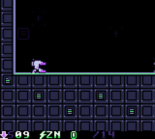
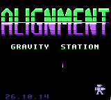
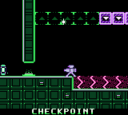
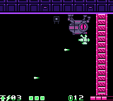
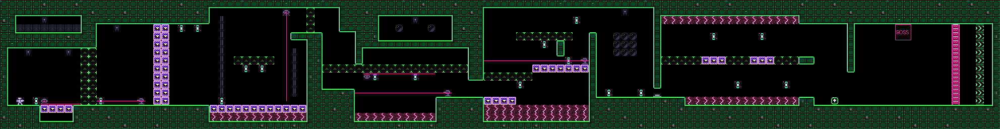

<h1 align="center">ALIGNMENT</h1>

<p align="center">
  <b>A gravity-flipping mech action game for the Game Boy and Game Boy Color.</b><br>
  <i>Sister cartridge to Infinite Best, Open World and Speedy Purple Peter. In the spirit of Metal Storm.</i>
</p>

<p align="center">
  
</p>

<p align="center">
  
  
  
</p>

---

The station has lost its alignment and its machines have turned on it. You pilot a small
armoured mech with an arm cannon and one trick: **press Up+A and gravity turns over.**
Floors become ceilings, a plasma lake becomes something you walk over upside down, and a
drone hanging from the ceiling becomes something you can land on.

Eight hand-made sectors, each a maze of rooms about two screens tall and twelve wide,
each with its own idea and a boss at the end. Clear the campaign and **ENDLESS** opens:
a station generated forever from a seed, with a boss every fourth stage.

## Controls

| Button | |
| --- | --- |
| **D-pad** | run |
| **A** | jump (hold for height) |
| **B** | fire the arm cannon (hold to repeat) |
| **Up+A** (or **SELECT**) | flip gravity: any time on the ground, once in the air |
| **START** | pause |

Falling onto an enemy along gravity crushes it, with a bounce and your air flip back.

## The station

| | Sector | Idea | Boss |
| --- | --- | --- | --- |
| 1 | Hangar Bay | running, shooting, the first flips, stomps | Sentinel, a walker that flips its own gravity |
| 2 | Reactor Core | phase blocks: purple is solid in one gravity, green in the other | Piston, a hammer whose core opens only after it slams |
| 3 | Foundry | crushers and laser gates in rhythm | The Hive, a floating core spraying spores |
| 4 | Cryo Vault | towers, hover drones, swapping floor and ceiling | Mirror Mech, which copies your flips |
| 5 | Sensor Array | turret gauntlets, cover to cover | Sentinel, faster |
| 6 | The Spine | climbs, falls and mid-air flip chains | Piston, faster |
| 7 | Gravity Vault | phase-block puzzles | The Hive, angrier |
| 8 | Station Core | everything at once | Mirror Mech, the final fight |

Power-ups hide in alcoves you reach with a clever flip: **P** power shot, **S** shield,
**B** gravity bomb (your next flip wrecks everything near), **+** hull repair. The hull
takes three hits; plasma, lasers and crushers take everything. Energy cells are score
(25 of them is an extra mech), and every sector has a checkpoint halfway.

## Built for every Game Boy

High-contrast black, electric purple and green on Color hardware (Game Boy Color,
Analogue Pocket, ModRetro Chromatic, GBA), with a crisp four-shade version for the
original Game Boy. On Color hardware it runs at a steady 60 fps. An original Game Boy
has half the speed and slows down briefly in the busiest fights, as the 8-bit classics
did.

<p align="center">
  
</p>
<p align="center"><sub>Sector 2, Reactor Core, as one picture (made by <code>tools/level_map.py</code> from the game itself)</sub></p>

## Every sector is proven beatable

`tests/physbot.c` plays the real game code (the same C the cartridge runs) with real
button presses and the cannon held down, and must finish every sector and boss **without
taking a single hit**. Boss fights are searched a move at a time with a beam of 1200
states, so the bot fights like a player, not a lawnmower. Then the ROM tests boot the
cartridge in an emulator, DMG and Color, feed it the bot's presses frame by frame, and
require the same result.

```
make                 # build/alignment.gb (GBDK-2020 4.3 in /opt/gbdk)
make test            # host tests (levels, bot, generator, sound), asset tests, ROM tests (PyBoy)
make maps            # build/maps/sectorN.png: every sector as one picture
build/msgen show s 3                        # a sector as text
build/msgen replay s 3 $(build/msgen path s 3)   # watch the bot's run, move by move
```

Making levels: see [docs/LEVEL_DESIGN.md](docs/LEVEL_DESIGN.md). A sector is a text map
in `assets/levels/`.

## Play it

- **Emulator:** any Game Boy emulator (SameBoy, Gambatte, mGBA, Emulicious...).
- **Real hardware:** the ROM is on the latest release; see [docs/EVERDRIVE.md](docs/EVERDRIVE.md).

The game saves your progress through the campaign, the best score and the best endless
stage in battery-backed RAM.

## Layout

| Path | |
| --- | --- |
| `src/core/` | portable C: physics, combat and bosses (`world.c`), sector loader, generator, run rules |
| `src/gb/` | Game Boy front end: play loop, rendering, effects, menus, sound driver, save |
| `assets/` | pixel art, music sources and the sector maps (`assets/levels/`) |
| `tests/` | the physics bot, ROM tests (PyBoy), asset and sound tests |
| `tools/` | `msgen`, level compiler, level viewer, asset and music generators, screenshots |
| `docs/` | contracts between code and assets, level design guide, EverDrive guide |
